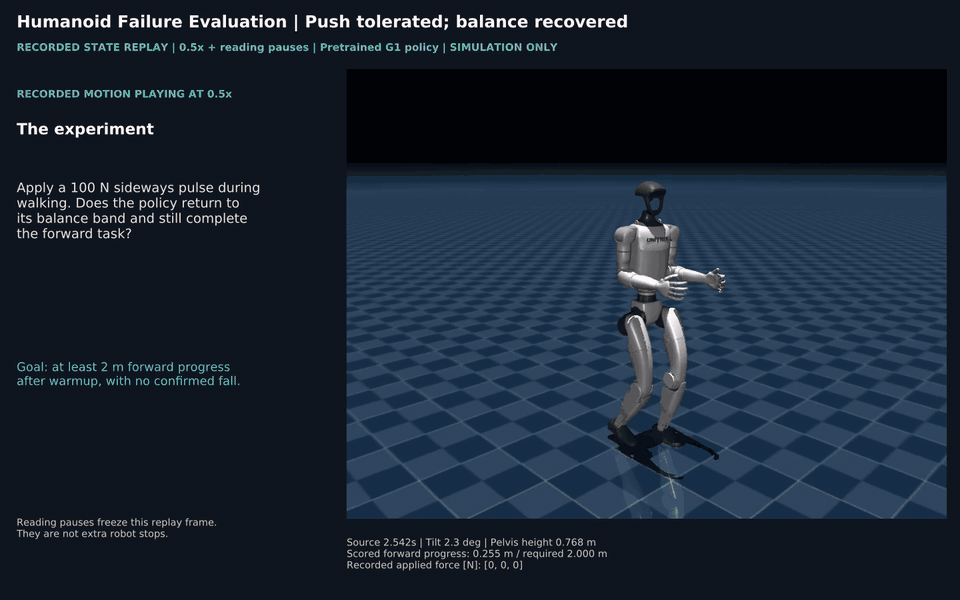

# Robotic Failure Evaluation

**[Watch the full two-robot walkthrough](artifacts/demo/00-two-robot-walkthrough.mp4)** · Animated excerpts above; full clips use 0.5× recorded-state playback and labeled reading pauses.

Evaluate **two existing walking policies** in MuJoCo: a Unitree G1 humanoid and a Unitree Go1 quadruped. Define scenarios, apply controlled disturbances, monitor simulator ground truth, reconstruct failures, and compare matched runs.

The current scope is deliberately small: **two robots, one forward-walking task, one external-push disturbance family**. Both use the same runner, logging format, outcome reporting and comparison tools. Robot adapters provide the different policy interfaces, models and monitoring thresholds. No policy training, new motion controller or physical hardware is involved.

## Define experiments and add robots

Robot profiles live in [configs/robots](configs/robots); reusable experiment recipes
live in [configs/experiments](configs/experiments). Choose robots, seeds, force levels,
directions and timing in JSON, then generate, execute and report with one command:

~~~bash
python scripts/evaluate.py --experiment configs/experiments/walking-push-sweep.json --output artifacts/my-evaluation --workers 2
~~~

A new compatible robot needs a JSON profile and an adapter for its existing
model/controller. The runner, disturbance scheduler, monitor and report require no
robot-name branches. If an existing adapter already supports its model/controller,
a profile alone is sufficient. Generated scenarios embed the profile and resolved
force vectors for reruns.

Forces support absolute newtons or multiples of simulated root-subtree body weight.
Reports separate robot/configuration/software versions and use actual sample counts.

**[How to add a robot, configure a sweep and generate reports](docs/extending.md)**

## What the demos actually show

| Robot | Clip | What happens and how it is evaluated |
| --- | --- | --- |
| G1 | [Normal walking](artifacts/demo/01-baseline.mp4) | The robot advances without a disturbance and completes the distance objective. |
| G1 | [Balance recovery](artifacts/demo/02-balance-recovery.mp4) | A 100 N sideways pulse disturbs walking. Posture and velocity return to the required band for 0.4 s; the robot then completes the task. |
| G1 | [Confirmed fall](artifacts/demo/03-fall.mp4) | A 250 N pulse leads to sustained pelvis/rigid-upper-body floor contact. The evaluator detects the contact and ends the episode. |
| G1 | [Upright task failure](artifacts/demo/04-upright-task-failure.mp4) | A 175 N backward pulse leaves the robot upright, but it advances only 1.819 m of the required 2 m: TASK_TIMEOUT. |
| Go1 | [Normal walking](artifacts/go1/demo/01-baseline.mp4) | Its pretrained policy drives twelve leg joints and completes the same distance objective. Normal foot contacts are accepted. |
| Go1 | [Balance recovery](artifacts/go1/demo/02-balance-recovery.mp4) | A 250 N lateral pulse is tolerated. The monitor independently checks body posture, velocity, and subsequent task completion. |
| Go1 | [Confirmed fall](artifacts/go1/demo/03-fall.mp4) | A matched 500 N pulse leads to sustained trunk-floor contact: FALL. |
| Go1 | [Posture violation](artifacts/go1/demo/04-posture-violation.mp4) | A 1000 N pulse violates the posture constraint. Sustained trunk-floor contact is not confirmed, so it is classified separately from FALL. |

The videos replay **saved physics states from real policy rollouts**, rather than running scripted robot animations. The original simulation clock, applied force, body tilt, height and progress remain visible. Red force arrows are explanatory graphics. Reading pauses freeze the replay; they are not extra robot stops or additional rollouts.

The G1 clips retain their original experiment title. The broader project now includes Go1 as well.

## The task, disturbance and detectors

Each episode commands forward walking at 0.5 m/s for 10 simulated seconds. The first 2 s are warmup; the robot must advance at least **2 m in world +X** during the remaining 8 s without a confirmed fall or persistent posture violation.

There is no lateral corridor constraint. Lateral displacement is recorded, so successful completion does not imply precise path tracking.

One optional **0.2 s world-frame force pulse** acts at the root body's center of mass. Its actual onset, end and integrated impulse are logged. This is an external physical disturbance, not simulated packet loss or a hardware fault.

| Check | G1 humanoid | Go1 quadruped |
| --- | --- | --- |
| Controlled joints | 12 leg joints; upper body/arms fixed | 12 leg joints |
| Existing policy | Unitree RL Gym recurrent TorchScript policy | MuJoCo Playground feedforward ONNX policy |
| Physics / policy / trace period | 2 ms / 20 ms / 20 ms | 4 ms / 20 ms / 20 ms |
| Confirmed FALL | Pelvis/rigid-upper-body floor contact for 0.02 s | Trunk-floor contact for 0.02 s |
| POSTURE_VIOLATION | Tilt >60° or root height <0.45 m for 0.1 s | Tilt >60° or root height <0.12 m for 0.1 s |
| Balance recovery | Tilt ≤10°, root height ≥0.65 m | Tilt ≤10°, root height ≥0.22 m |

Recovery additionally requires |world vx − commanded vx| ≤0.25 m/s and |world vy| ≤0.25 m/s continuously for 0.4 s after the pulse ends. The evaluator **observes recovery by the existing policy**. It does not add a recovery controller or implement getting up.

G1's fixed arms/head share the pelvis rigid body. Go1 uses the upstream **full-collision** flat-floor model, rather than the deployment example's feet-only terrain model, so trunk-floor contact is observable. These are operational model-specific detectors, not universal definitions of every possible robotic fall.

| Final outcome | Required evidence |
| --- | --- |
| COMPLETED | Full horizon, sufficient scored progress, no confirmed fall or persistent posture violation |
| FALL | Sustained root-body floor contact; terminate the episode |
| POSTURE_VIOLATION | Persistent tilt/height constraint violation without confirmed FALL |
| TASK_TIMEOUT | Valid simulation reaches the task horizon without sufficient progress |
| INFRASTRUCTURE_ERROR / TIMEOUT | Setup, worker, receipt or parent wall-clock failure; excluded from robot-failure counts |
| INVALID_SIMULATION | Numerical state/warnings invalidate the episode |

Priority is FALL, then POSTURE_VIOLATION, then distance-based completion/timeout. A past posture violation remains a task failure even if the policy later changes posture. An injected push is not automatically a failure.

## Measured results

These are the archived two-robot campaign results. New modular workflow checks are reported separately in [the extension verification](docs/modularity-verification.md).

**72 evaluation episodes: 40 G1 and 32 Go1. Zero infrastructure failures in these batches.** Pilots, reset checks, infrastructure-injection checks and reproduction runs are stored separately and are not added to this denominator.

| Robot | Pulse force for 0.2 s | Completed | Falls | Posture violations | Task timeouts |
| --- | --- | --- | --- | --- | --- |
| G1 | None | 8 | 0 | 0 | 0 |
| G1 | 25 N | 8 | 0 | 0 | 0 |
| G1 | 100 N | 8 | 0 | 0 | 0 |
| G1 | 175 N | 4 | 2 | 0 | 2 |
| G1 | 250 N | 0 | 8 | 0 | 0 |
| Go1 | None | 8 | 0 | 0 | 0 |
| Go1 | 250 N | 7 | 1 | 0 | 0 |
| Go1 | 500 N | 0 | 7 | 1 | 0 |
| Go1 | 1000 N | 0 | 4 | 4 | 0 |

Each robot uses eight matched seeded direction/onset schedules per pushed condition. Directions are world ±X/±Y; onset is sampled in [3.0, 3.8] s and quantized to the robot's physics step.

**These tables do not rank the robots.** Masses, policies, collision models, physics steps and chosen force ranges differ. Go1 having fewer confirmed falls at 1000 N than 500 N does not indicate improvement: every episode in both conditions failed, with different observed failure categories.

This is an exploratory campaign. G1's 175 N follow-up was chosen after initial bracketing; Go1's force tiers were chosen after its pilots. Nominal references are identical reset repetitions, not independent reliability samples. Zero falls among eight trials still leaves an approximately **32% upper 95% Wilson limit** under the stated sampling interpretation.

- [Combined evaluation report and uncertainty](artifacts/two-robot/evaluation/report.md)
- [Machine-readable results](artifacts/two-robot/evaluation/summary.json)
- [Original G1 report](artifacts/evaluation/report.md)
- [Go1 campaign receipts](artifacts/go1/campaign/batch.json)

## Verification and failure reconstruction

**41 tests pass**, including real foot/body contacts, policy resets, process failures, robot-specific manifests, matched comparisons, uncertainty calculations and separate aggregation for both robots.

A selected G1 fall was reproduced three times; a selected Go1 fall was reproduced twice in fresh processes. Their recorded joint traces matched exactly locally. That is evidence about this environment, not a cross-machine determinism guarantee.

The Go1 worker was also deliberately killed after execution began, and a separate run exceeded its parent's wall-clock deadline. These were correctly classified as infrastructure failures, not robot falls. A current-code G1 baseline check preserved the original nominal progress after the adapter refactor.

- [Current test output](artifacts/modularity/tests.log)
- [Go1 reproduction evidence](artifacts/go1/reproductions/summary.json)
- [Go1 infrastructure checks](artifacts/go1/infrastructure/summary.json)
- [G1 compatibility check](artifacts/two-robot/g1-compatibility-check.json)
- [Two-robot verification record](docs/two-robot-verification.md)
- [Modular extension verification](docs/modularity-verification.md)

## Architecture and reuse

~~~mermaid
flowchart TD
    A[Scenario JSON: g1 or go1] --> B[Shared parent runner]
    B --> C[Fresh episode process]
    C --> D[G1 TorchScript adapter]
    C --> E[Go1 ONNX adapter]
    D --> F[Existing MuJoCo model and actuators]
    E --> F
    G[Scheduled external force] --> F
    F --> H[Ground-truth monitor with robot-specific limits]
    H --> I[Scenario, manifest, trace, events and result]
    I --> J[Shared report and matched-run comparison]
    I --> K[Annotated recorded-state replay]
~~~

| Reused | Project implementation |
| --- | --- |
| MuJoCo physics, contacts, sensors, actuator dynamics and rendering | Fresh-process orchestration, scenario validation, wall deadlines and cleanup |
| Unitree G1 model, trained policy, PD/observation math | Headless G1 adapter; float32 observations and recurrent reset |
| MuJoCo Playground Go1 model/policy/deployment convention; Menagerie meshes | Headless Go1 adapter; direct command input replacing gamepad, local ONNX session |
| pytest, NumPy, FFmpeg | Robot-specific outcome monitoring, force scheduling, compact evidence, reporting and demo annotations |

The adapters share robot-independent state and provenance helpers. JSON profiles select adapter factories and monitoring limits; experiment recipes resolve into explicit scenarios. No database or distributed scheduler is introduced. The source package is `robot_eval`. Old G1 artifacts remain immutable with their original source fingerprints.

## Setup

Validated with Python 3.12.15, MuJoCo 3.5.0, PyTorch 2.10.0, NumPy 2.2.6 and ONNX Runtime 1.20.1. Physics and policy inference run on CPU. Video export additionally needs FFmpeg and an EGL-capable graphics setup; tests and headless experiments do not need a simulator window.

~~~bash
git clone https://github.com/hiteshhedwig/robotic-failure-evaluation.git
cd robotic-failure-evaluation
# Use an isolated Python 3.12 environment.
python -m pip install torch==2.10.0 --index-url https://download.pytorch.org/whl/cpu
python -m pip install -r requirements.txt
python scripts/bootstrap.py
python scripts/bootstrap.py --verify
~~~

Bootstrap fetches pinned sparse upstream checkouts, verifies policy hashes, and refuses modified or mismatched dependencies. ONNX Runtime is installed under `.runtime/python` without changing the active environment's packages. Training frameworks, Isaac Gym, JAX and physical robot SDKs are not required.

The inspected machine reuses its existing `lerobot` environment. Fresh setup instructions are a reproducible recipe, not a claim that every operating system/package combination was tested.

## Run and inspect

One G1 or Go1 episode, each into a **new** output directory:

~~~bash
python scripts/run_experiment.py --scenario configs/push-y-100.json --output artifacts/my-g1
python scripts/run_experiment.py --scenario configs/go1/push-y-120.json --output artifacts/my-go1
~~~

Run a Go1 batch and produce a report with the archived G1 campaigns:

~~~bash
python scripts/run_experiment.py --suite configs/go1/campaign.json --output artifacts/my-go1-campaign --workers 2
python scripts/report.py artifacts/campaign artifacts/boundary artifacts/my-go1-campaign --output artifacts/my-report
~~~

Rerun a recorded failure and compare matched receipts:

~~~bash
python scripts/run_experiment.py --scenario artifacts/go1/campaign/strong-seed0/scenario.json --output artifacts/my-go1-reproduction
python scripts/compare.py --reference artifacts/go1/campaign/strong-seed0 --candidate artifacts/my-go1-reproduction --output artifacts/my-go1-comparison.json
python -m pytest tests -q
~~~

The supervisor CLI returns success when it records a valid robot outcome, including FALL. Inspect the outcome in `supervisor.json`; an exit code of zero is not proof of task completion. Infrastructure failures return a nonzero supervisor exit code.

Every trial saves:
- `scenario.json`: robot, seed, command, objective and pulse.
- `manifest.json`: versions, upstream revisions, model/policy/source hashes, initial state, timing and detector configuration.
- `trace.jsonl`: 50 Hz sampled state, actual actuator efforts, policy actions, contacts and applied forces.
- `events.jsonl`: physics-step detection timestamps and injection intervals.
- `result.json` and `supervisor.json`: task outcome and process-level receipt.

For Go1, position targets are separate from actual actuator efforts. G1's effort commands drive torque actuators. Physics-step monitoring is finer than the sampled trace; cached simulator kinematics may lag the integrated state by one physics step.

## Rebuild the demos

~~~bash
python scripts/render_go1_demo.py
python scripts/assemble_demo.py
python scripts/make_readme_gif.py
~~~

The current G1 videos and their export sources are archived under `artifacts/demo`. Go1 replay generation loads its pinned model and saved states without executing a new policy rollout. Rebuilding the full G1 render is available through `scripts/render_demo.py`.

## Limits and next scope

This is a compact **two-robot evaluation platform**, not a general robotics benchmark. The current scenarios cover flat-floor walking and one external disturbance family. There are no perception faults, navigation tasks, manipulation tasks, learned diagnosis, get-up controller or hardware validation.

Contact/posture detectors establish measurable outcomes; they do not establish why a learned policy failed internally. A robot can violate posture without satisfying this project's root-contact fall definition. Both are retained as task failures.

Future robot support should reuse the runner and evidence format while supplying a validated model, existing controller/policy, and task-specific monitors. G1 and Go1 remain the two validated robot models. The adapter/profile contract supports adding future MuJoCo walking robots without changing experiment execution or reporting.

[Architecture](docs/architecture.md) · [Two-robot verification](docs/two-robot-verification.md) · [Upstream attribution](THIRD_PARTY_NOTICES.md)
