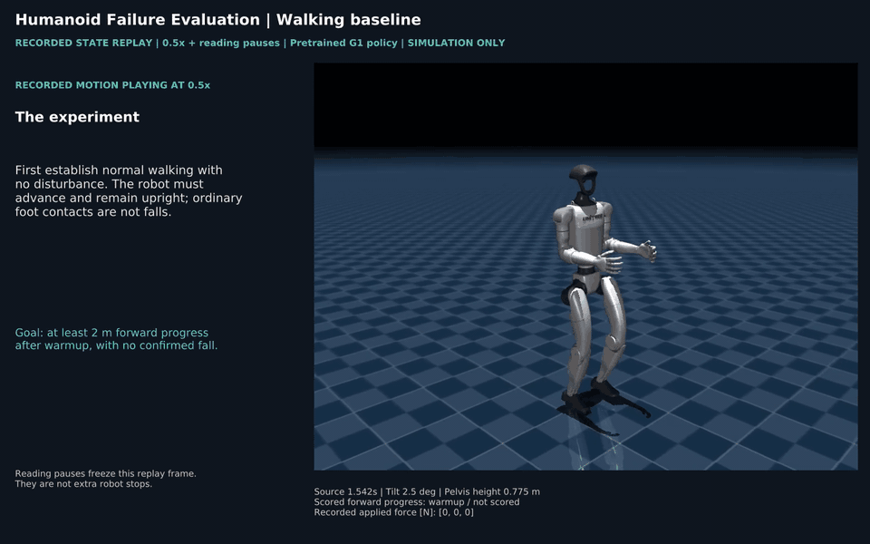

# Humanoid Failure Evaluation

**[Watch the full MP4 walkthrough](artifacts/demo/00-complete-walkthrough.mp4)** · Animated preview of selected recorded results; full walkthrough includes 0.5× playback and explanation pauses.

**Test how a pretrained G1 walking policy responds to controlled pushes in MuJoCo.**

One humanoid, one walking task, one disturbance family, and a small experiment pipeline.
The work is in orchestration, ground-truth monitoring, outcome classification,
reproduction and evaluation. The robot model and walking policy come from Unitree;
no policy is trained here.

## Watch the experiment

| Chapter | What happens | What it demonstrates |
| --- | --- | --- |
| [Walking baseline](artifacts/demo/01-baseline.mp4) | No push; the robot completes the forward-distance task | Establish normal behavior first |
| [Balance recovery](artifacts/demo/02-balance-recovery.mp4) | A 100 N sideways pulse disturbs the robot; it regains its balance band and completes | A disturbance is not automatically a failure |
| [Fall](artifacts/demo/03-fall.mp4) | A 250 N pulse leads to sustained upper-body ground contact | Failure detection uses physical state/contact evidence |
| [Upright but unsuccessful](artifacts/demo/04-upright-task-failure.mp4) | A 175 N backward pulse leaves the robot upright, but it advances only 1.819 m of the required 2 m | No fall does not imply task success |

Clips render **actual saved physics states at 0.5× speed with labeled reading pauses**.
Force arrows are explanatory graphics. Frozen reading frames are not extra robot stops.
The footer shows the original simulation clock and measurements. Replays do not claim
additional policy rollouts. All five exports were fully decoded and representative
frames were visually checked.

### The exact task and disturbance

- Command forward walking at 0.5 m/s.
- Run for 10 simulated seconds, including 2 seconds of warmup.
- Require at least **2 m of world +X progress** during the remaining 8 seconds.
- Require no confirmed fall or persistent posture violation.
- Optionally apply one 0.2 s external force pulse to the rigid pelvis/upper-body body.
- Record the applied interval, impulse, physical response and outcome separately.

The model has **12 controlled leg joints; its arms are fixed**. This is an existing
recurrent walking policy acting through simulated joint efforts, not scripted pose
animation. There is no lateral corridor constraint; lateral displacement is recorded.

### What is a failure or recovery?

| Outcome | Evidence |
| --- | --- |
| COMPLETED | Full horizon, >=2 m scored progress, no confirmed fall or persistent posture violation |
| FALL | Ground contact on the model's pelvis/rigid-upper-body body persists for 0.02 s |
| POSTURE_VIOLATION | Tilt >60 degrees or root height <0.45 m persists for 0.1 s, without a confirmed fall |
| TASK_TIMEOUT | Valid simulation reaches its task horizon without the required progress |
| INFRASTRUCTURE_ERROR / TIMEOUT | Setup, worker, receipt or wall-clock failure; excluded from robot-failure counts |
| INVALID_SIMULATION | Numerical state/warnings invalidate the episode |

Foot-floor contact is normal. The model's head and fixed arms share the pelvis body;
this operational contact criterion is specific to the reduced model.

Balance recovery is a return to predefined posture/velocity bands for 0.4 s after the
pulse ends. The evaluator **observes recovery by the existing policy**, rather than
adding a recovery controller. It does not implement getting up. The fourth clip shows
that balance recovery and task completion are separate outcomes.

## Measured evaluation

Forty episodes covered eight matched direction/onset schedules across five conditions.
The initial 32 used reference, 25 N, 100 N and 250 N conditions. An exploratory midpoint
follow-up added eight 175 N cases after the initial 100/250 N bracket was observed.

| Force for 0.2 s | Completed | Falls | Task timeouts |
| --- | --- | --- | --- |
| None | 8/8 | 0/8 | 0/8 |
| 25 N | 8/8 | 0/8 | 0/8 |
| 100 N | 8/8 | 0/8 | 0/8 |
| 175 N | 4/8 | 2/8 | 2/8 |
| 250 N | 0/8 | 8/8 | 0/8 |

**Zero infrastructure failures occurred in these 40 evaluation episodes.** Separate
checks killed an initialized worker and enforced a parent deadline.

These are conditional, exploratory results for one model, policy, floor and disturbance
distribution. Eight zero-fall trials still have an approximate **32% upper 95% Wilson
limit**. They do not establish a fall-free robot. Reference repeats are identical
nominal resets, not independent reliability samples. Force tiers use matched schedules.

One selected fall was reproduced three times in fresh processes at the same simulated
time. Recorded joint traces matched exactly locally; bitwise cross-machine determinism
is not promised. **16 tests passed**, covering actual contacts, recurrent reset,
process failures, comparison and uncertainty calculations.

- [Evaluation report and uncertainty](artifacts/evaluation/report.md)
- [Machine-readable summary](artifacts/evaluation/summary.json)
- [Initial batch](artifacts/campaign/batch.json) and [midpoint follow-up](artifacts/boundary/batch.json)
- [Failure reproduction](artifacts/reproductions/summary.json)
- [Test output](artifacts/tests.log) and [verification record](docs/verification.md)

## Architecture and reuse

~~~mermaid
flowchart TD
    A[Scenario JSON] --> B[Parent runner with wall timeout]
    B --> C[Fresh G1 worker]
    C --> D[Existing Unitree walking policy]
    D --> E[MuJoCo robot physics]
    F[Scheduled external push] --> E
    E --> G[Ground-truth monitor]
    G --> H[Outcome, trace, events and manifest]
    H --> I[Comparison and report]
    H --> J[Annotated state replay]
~~~

| Reused | Implemented here |
| --- | --- |
| Unitree model, meshes, pretrained LSTM and configuration | Scenario definitions and isolated episode execution |
| Upstream PD and gravity-orientation math | Timed force injection and impulse records |
| MuJoCo physics, contacts and rendering | Outcome/recovery monitoring and process-failure handling |
| NumPy, PyTorch, pytest | Evidence collection, comparison, analysis and replay |

The upstream deployment is pinned at `276801e46c5d433564f24658bac64f254b7d2d4b`.
Vendor files are not patched. The adapter removes GUI pacing, uses simulation-step
termination, and supplies float32 observations because the checkpoint rejects the
original example's float64 buffer in the tested environment.

Each episode resets **physics, LSTM memory, previous action and phase**. A random seed
alone would not reset the recurrent policy.

## Setup and run

Validated with Python 3.12.15, MuJoCo 3.5.0, PyTorch 2.10.0, NumPy 2.2.6,
PyYAML 6.0.3 and pytest 9.1.1. Physics and policy inference are CPU-only.

On the inspected machine, reuse the existing environment without modifying it:

~~~bash
conda activate lerobot
python scripts/bootstrap.py --verify
~~~

For a fresh setup, provide Python 3.12 in an isolated environment, then:

~~~bash
python -m pip install torch==2.10.0 --index-url https://download.pytorch.org/whl/cpu
python -m pip install -r requirements.txt
python scripts/bootstrap.py
~~~

Bootstrap fetches only the pinned model/deployment subset, checks the policy checksum,
and refuses to overwrite a mismatched or modified checkout. The validated checkout
occupies about 82 MB. Fresh installation is a recipe, not a claim of portability to
every OS or package build.

Run one protected episode into a **new** directory:

~~~bash
python scripts/run_experiment.py \
  --scenario configs/push-y-100.json --output artifacts/my-trial
~~~

Run the matched experiments and report:

~~~bash
python scripts/run_experiment.py \
  --suite configs/campaign.json --output artifacts/my-campaign --workers 2
python scripts/run_experiment.py \
  --suite configs/boundary.json --output artifacts/my-boundary --workers 2
python scripts/report.py artifacts/my-campaign artifacts/my-boundary \
  --output artifacts/my-evaluation
~~~

Runner exit zero means valid evidence was collected, not that every robot task
succeeded. A robot FALL is distinct from a crashed experiment process.

Reproduce a failure and compare the matched execution:

~~~bash
python scripts/run_experiment.py \
  --scenario artifacts/campaign/strong-seed0/scenario.json \
  --output artifacts/my-reproduced-fall
python scripts/compare.py \
  --reference artifacts/campaign/strong-seed0 \
  --candidate artifacts/my-reproduced-fall \
  --output artifacts/my-comparison.json
~~~

The comparator rejects unmatched inputs and can flag new task failures or infrastructure
errors in a future version. Current verification compares unchanged reproduced runs;
no controller improvement or statistical software-version regression is claimed.

~~~bash
python -m pytest tests -q
python scripts/render_demo.py
~~~

Rendering rebuilds videos from recorded states, without a new policy rollout. It needs
ffmpeg/ffprobe and an OpenGL backend. EGL was used; CPU OSMesa works but is slower.
The experiment runner requires no GUI, ROS, training stack, physical robot or paid service.

## Evidence and scope

Valid runs contain `scenario.json`, `manifest.json`, `trace.jsonl`, `events.jsonl`,
`result.json` and `supervisor.json`. Together these record realized inputs, software
and model hashes, initial conditions, policy output, physical state, contact events,
timing and process status. A crash can leave a partial trace and no worker result;
the parent records that absence as infrastructure failure.

One end-to-end milestone was built through four verified gates: baseline, measurable
disturbance outcomes, isolated runs/reproduction, and evaluation/demo. Read the
[architecture and definitions](docs/architecture.md) and [baseline notes](docs/gate1.md).

This prototype does not train a controller, diagnose a policy's internal failure
mechanism, provide a universal fall detector, validate physical safety, or establish
a large-scale benchmark. Eight schedules and an exploratory refinement provide limited
evidence. Simulation fidelity and fixed upper-body geometry limit hardware transfer.

## Upstream credit

Model, policy and deployment math: [Unitree RL Gym](https://github.com/unitreerobotics/unitree_rl_gym).
Physics/rendering: [MuJoCo](https://github.com/google-deepmind/mujoco).
[Upstream license and attribution](THIRD_PARTY_NOTICES.md) are retained.
